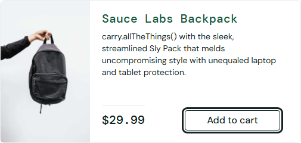

# saucedemo.com — автоматизоване тестування доступності (WCAG 2.1 AA)

[](https://github.com/OWNER/REPO/actions/workflows/a11y.yml)
[](https://OWNER.github.io/REPO/)

> Після створення репозиторію замініть `OWNER/REPO` у двох рядках вище.

Портфоліо-проєкт QA: фреймворк для перевірки доступності (a11y) вебзастосунку на **Playwright + axe-core**. Це не «виклик бібліотеки в одному тесті», а повний набір: фікстури, Page Objects, baseline відомих порушень, клавіатурні тести у трьох браузерах, звітність і CI з публікацією звіту на GitHub Pages.

**Об'єкт тестування:** https://www.saucedemo.com (публічний демо-магазин, користувач `standard_user` / `secret_sauce`).

## Головний результат

| Що | Результат |
|---|---|
| axe-core, теги `wcag2a` `wcag2aa` `wcag21a` `wcag21aa`, 7 сторінок + 7 станів UI | **0 порушень** WCAG 2.1 A/AA; 1 правило потребує ручної перевірки (перевірено, контраст ≈15:1) |
| Клавіатурні тести (Chromium, Firefox, WebKit) + ручна перевірка | **11 проблем**, зокрема 1 Critical: користувач клавіатури **не може дістатися до кошика** і завершити покупку |

Сайт «чистий» для автоматичного сканера, але недоступний для людини з клавіатурою. Саме тому фреймворк поєднує axe-сканування з клавіатурними тестами, а всі знахідки задокументовано в [A11Y-REPORT.md](A11Y-REPORT.md).

| Фокус на «Add to cart»: як є (A11Y-001) | З рекомендованим `:focus-visible` |
|---|---|
|  |  |

## Стек

- Node.js 22.18+ (скрипти `scripts/*.ts` запускаються нативно, без `tsx`), TypeScript strict
- `@playwright/test` 1.65, `@axe-core/playwright` / `axe-core` 4.14
- ESLint (`typescript-eslint` type-checked, `eslint-plugin-playwright`), Prettier
- GitHub Actions (matrix за браузерами) + GitHub Pages

## Швидкий старт

```bash
git clone https://github.com/OWNER/REPO.git && cd REPO
npm ci
npx playwright install chromium firefox webkit   # на Linux/CI: --with-deps
npm test                                          # ~3 хв: unit + axe + keyboard у 3 браузерах
npm run report                                    # відкрити HTML-звіт Playwright
```

| Команда | Що робить |
|---|---|
| `npm test` | усі тести (unit, smoke, axe, keyboard) |
| `npm run test:a11y` | лише axe-сканування (`tests/a11y`, Chromium) |
| `npm run test:keyboard` | лише клавіатурні тести (3 браузери) |
| `npm run test:headed` | з видимим браузером |
| `npm run a11y:summary` | `reports/a11y-summary.md` + `.html` з результатів сканувань |
| `npm run pages:build` | зібрати сайт звітів у `site/` |
| `npm run baseline:update` | перезаписати `a11y-baseline.json` поточним станом |
| `npm run typecheck` / `lint` / `format` | статичні перевірки |

Змінні оточення (необов'язкові): `BASE_URL`, `SAUCE_USERNAME`, `SAUCE_PASSWORD`, `SAUCE_LOCKED_USERNAME`.

## Архітектура

```
src/
├── config/env.ts              # baseURL і демо-облікові дані (перевизначаються через env)
├── pages/                     # Page Objects: лише локатори й дії, без expect
│   ├── BasePage.ts            # path, goto(), a11yExclude — виключення для axe живуть тут
│   ├── AuthenticatedPage.ts   # спільна шапка: бургер-меню, кошик
│   └── components/BurgerMenu.ts
├── fixtures/pages.fixture.ts  # фікстури Page Objects + loggedInPage (UI-логін раз на воркер)
├── a11y/
│   ├── axe.fixture.ts         # makeAxeBuilder (єдине місце з тегами WCAG) + a11yScan
│   ├── scan.ts                # запуск axe → порівняння з baseline → анотації → assert
│   ├── baseline.ts            # new / known / fixed, детермінований формат файлу
│   ├── records.ts             # запис reports/a11y-results/<scanKey>.json
│   ├── format.ts              # людиночитні повідомлення про порушення
│   ├── summary.ts             # агрегація → Markdown / HTML
│   └── pages-index.ts         # головна сторінка GitHub Pages
└── keyboard/focus.ts          # tabUntil, getFocusedElementInfo, isFocusVisible, auditFocusIndicators
tests/
├── unit/                      # unit-тести хелперів (без браузера) + axe-перевірка згенерованих сторінок
├── smoke/                     # повний шлях покупки через Page Objects
├── a11y/                      # pages / states / baseline-guard
├── keyboard/                  # login / inventory / menu / checkout / focus-visible
└── support/                   # спільні очікування для тестів (стан меню, примітки щодо браузерів)
scripts/                       # baseline-update, a11y-summary, build-pages, docs-screenshots
```

### Як працює сканування

```
test ──► a11yScan('inventory:menu-open', { include, exclude })
           │  axe-core з тегами WCAG 2.1 A/AA (лише з фікстури)
           ▼
        violations ──► compareWithBaseline(a11y-baseline.json[scanKey])
           │              ├─ new critical/serious  → тест ПАДАЄ (з форматованим списком)
           │              ├─ new moderate/minor    → анотація warning
           │              ├─ зникли з baseline     → анотація fixed-since-baseline
           │              └─ axe "incomplete"      → анотація needs-review
           ├─► testInfo.attach(axe JSON + текст)   → HTML-звіт Playwright
           └─► reports/a11y-results/<scanKey>.json → a11y-summary, GitHub Job Summary, Pages
```

- **Ключ стану (`scanKey`)** пов'язує сканування з baseline: `login`, `login:error`, `inventory:menu-open`, `checkout-step-one:validation-errors`…
- **Baseline** (`a11y-baseline.json`) має формат `{ [scanKey]: ruleId[] }`. Гранулярність на рівні rule id — свідомий компроміс: файл стабільний і зручний для рев'ю, але нова нода вже відомого правила тест не валить.
- Baseline оновлюється **лише** через `npm run baseline:update`. Скрипт проганяє сканування в режимі запису й виводить diff, який потрібно пояснити в коміті.
- **Тест-доказ** `baseline-guard` вставляє на сторінку `` без `alt` і перевіряє, що сканування падає з новим critical-порушенням `image-alt`. Так ми знаємо, що «зелений» baseline справді щось перевіряє.
- Сканування стану починається лише після появи конкретного локатора (жодних `waitForTimeout`). Для меню — після завершення CSS-анімації (`transform: none`).

### Клавіатурні тести

- Хелпери в `src/keyboard/focus.ts` визначають роль і доступне ім'я сфокусованого елемента через accessibility snapshot Playwright. `tabUntil` у разі невдачі показує весь пройдений шлях фокуса.
- **Реальні баги не підганяються під тест:** такий тест позначено `test.fail()` з ID з A11Y-REPORT. Після виправлення на сайті Playwright повідомить «expected to fail, but passed», і позначку треба буде прибрати. Кожен `test.fail` перевірено: він падає саме на очікуваній перевірці, а не через таймаут.
- WebKit (як і Safari за замовчуванням) не включає посилання в Tab-послідовність, тому тести, яким це потрібно, у WebKit пропускаються з поясненням.

## Звіти

| Артефакт | Де |
|---|---|
| HTML-звіт Playwright (трейси, скриншоти, axe JSON у вкладеннях, анотації) | `playwright-report/`, у CI — злитий з трьох браузерів |
| Зведення axe: таблиця scanKey × impact, топ правил, needs review | `reports/a11y-summary.md` / `.html`, GitHub Job Summary |
| Сайт звітів | `site/` → GitHub Pages |


## CI/CD

`.github/workflows/a11y.yml` запускається на `push` у `main`, на `pull_request`, вручну (`workflow_dispatch`) і щотижня за розкладом (сайт живий і може змінитися):

1. **lint** — `typecheck`, ESLint, Prettier.
2. **test** — matrix `chromium` / `firefox` / `webkit`: кеш npm, `playwright install --with-deps <browser>`, blob-звіти й `reports/` як артефакти (14 днів). Chromium додатково запускає unit-тести й axe-сканування.
3. **summary** — `merge-reports` в один HTML/JSON-звіт, зведення axe в Job Summary, збірка `site/`.
4. **deploy-report** (лише `main`) — `upload-pages-artifact` + `deploy-pages`.

Перед першим запуском: **Settings → Pages → Source: GitHub Actions**. Retries: 2 у CI, 0 локально. У menu-спеку retries увімкнено завжди, бо фокус у меню керується нестабільно на боці застосунку (A11Y-003), тож такі прогони в звіті позначаються як flaky, а не приховуються.

## Обмеження

Автоматизація не замінює ручного аудиту: axe знаходить лише частину проблем, а скрінрідерна перевірка проводиться вручну. Детальніше — у розділі [«Обмеження автоматизації»](A11Y-REPORT.md#обмеження-автоматизації) звіту.

## Що я б додав далі

- Окремий проєкт зі свідомо недоступним сайтом для порівняння ефективності підходу.
- Перевірку на рівні нод (target-селектори) для критичних правил, наприклад `color-contrast`, на додачу до rule id.
- Автоматичну перевірку `document.title` при SPA-навігації (A11Y-008) і зв'язку помилок із полями (A11Y-010).
- Тести зі скрінрідером (Guidepup / NVDA) для перевірки фактичних оголошень.
- Створення GitHub Issue з нового порушення в CI за розкладом.
