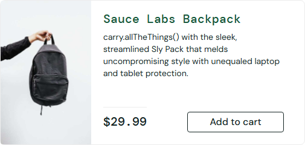
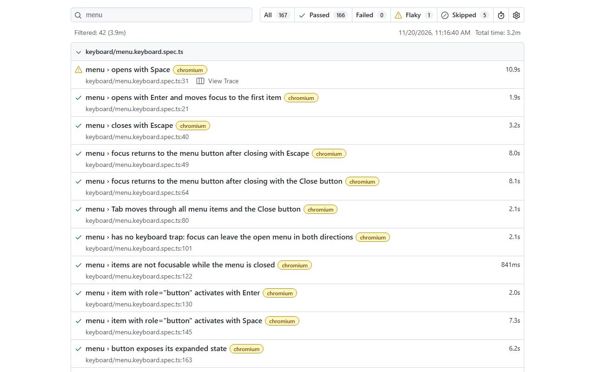
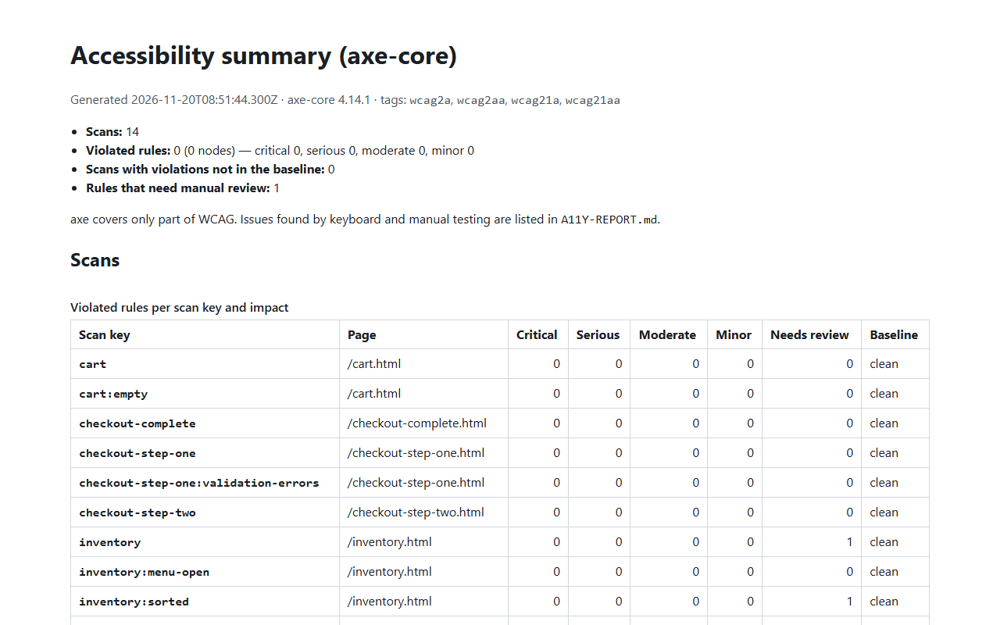

# Автоматизоване тестування доступності (WCAG 2.1 AA)

[](https://github.com/OWNER/REPO/actions/workflows/a11y.yml)
[](https://OWNER.github.io/REPO/)

## Головний результат

| Що | Результат |
|---|---|
| axe-core, теги `wcag2a` `wcag2aa` `wcag21a` `wcag21aa`: 31 сканування (7 сторінок + 7 станів UI на десктопі й на мобільному в'юпорті, 3 у режимі `forced-colors`) | **0 порушень** WCAG 2.1 A/AA; 1 правило потребує ручної перевірки (перевірено, контраст ≈15:1) |
| Клавіатурні тести (Chromium, Firefox, WebKit), медіа-налаштування, піксельні перевірки фокуса, ручна перевірка | **12 проблем**, зокрема 1 Critical: користувач клавіатури **не може дістатися до кошика** і завершити покупку |

Сайт «чистий» для автоматичного сканера, але недоступний для людини з клавіатурою. Саме тому фреймворк поєднує axe-сканування з клавіатурними тестами, а всі знахідки задокументовано в [A11Y-REPORT.md](A11Y-REPORT.md).

| Фокус на «Add to cart»: як є (A11Y-001) | З рекомендованим `:focus-visible` |
|---|---|
|  |  |


| Команда | Що робить |
|---|---|
| `npm test` | усі тести (unit, smoke, axe, keyboard) |
| `npm run test:a11y` | лише axe-сканування (`tests/a11y`: Chromium + мобільний в'юпорт) |
| `npm run test:keyboard` | лише клавіатурні тести (3 браузери) |
| `npm run test:headed` | з видимим браузером |
| `npm run a11y:summary` | `reports/a11y-summary.md` + `.html` з результатів сканувань |
| `npm run pages:build` | зібрати сайт звітів у `site/` |
| `npm run baseline:update` | перезаписати `a11y-baseline.json` поточним станом |
| `npm run typecheck` / `lint` / `format` | статичні перевірки |

Змінні оточення (необов'язкові): `BASE_URL`, `SAUCE_USERNAME`, `SAUCE_PASSWORD`, `SAUCE_LOCKED_USERNAME`.

### Як працює сканування

```
test ──► a11yScan('inventory:menu-open', { include, exclude })
           │  axe-core з тегами WCAG 2.1 A/AA (лише з фікстури)
           ▼
        violations ──► compareWithBaseline(a11y-baseline.json[scanKey])
           │              ├─ new critical/serious  → тест ПАДАЄ (з форматованим списком)
           │              ├─ new moderate/minor    → анотація warning
           │              ├─ зникли з baseline     → анотація fixed-since-baseline
           │              └─ axe "incomplete"      → анотація needs-review
           ├─► testInfo.attach(axe JSON + текст)   → HTML-звіт Playwright
           └─► reports/a11y-results/<scanKey>.json → a11y-summary, GitHub Job Summary, Pages
```

- **Ключ стану (`scanKey`)** пов'язує сканування з baseline: `login`, `login:error`, `inventory:menu-open`, `checkout-step-one:validation-errors`…
- **Baseline** (`a11y-baseline.json`) має формат `{ [scanKey]: ruleId[] }`. Гранулярність на рівні rule id — свідомий компроміс: файл стабільний і зручний для рев'ю, але нова нода вже відомого правила тест не валить.
- Baseline оновлюється **лише** через `npm run baseline:update`. Скрипт проганяє сканування в режимі запису й виводить diff, який потрібно пояснити в коміті.
- **Тест-доказ** `baseline-guard` вставляє на сторінку `` без `alt` і перевіряє, що сканування падає з новим critical-порушенням `image-alt`. Так ми знаємо, що «зелений» baseline справді щось перевіряє.
- Сканування стану починається лише після появи конкретного локатора (жодних `waitForTimeout`). Для меню — після завершення CSS-анімації (`transform: none`).

### Клавіатурні тести

- Хелпери в `src/keyboard/focus.ts` визначають роль і доступне ім'я сфокусованого елемента через accessibility snapshot Playwright. `tabUntil` у разі невдачі показує весь пройдений шлях фокуса.
- **Реальні баги не підганяються під тест:** такий тест позначено `test.fail()` з ID з A11Y-REPORT. Після виправлення на сайті Playwright повідомить «expected to fail, but passed», і позначку треба буде прибрати. Кожен `test.fail` перевірено: він падає саме на очікуваній перевірці, а не через таймаут.
- WebKit (як і Safari за замовчуванням) не включає посилання в Tab-послідовність, тому тести, яким це потрібно, у WebKit пропускаються з поясненням.

### Мобільний в'юпорт, медіа-налаштування, візуальні перевірки

- **Мобільний в'юпорт:** проєкт `mobile-chromium` (метрики `devices['iPhone 13']` на Chromium, щоб результати axe були порівнянні з десктопним baseline) повторює всі сканування сторінок і станів. Ключі отримують суфікс `@mobile` (`metadata.a11yVariant` проєкту).
- **forced-colors:** axe-сканування з `forcedColors: 'active'` (ключі `@forced-colors`) і перевірка, що індикатор фокуса видно в режимі високого контрасту (A11Y-001).
- **prefers-reduced-motion:** чи вимикає застосунок анімацію меню (A11Y-012) — у всіх трьох рушіях.
- **Візуальні фокус-стани** (`tests/visual`): піксельне порівняння області до і після фокуса (не потребує еталонів, працює на будь-якій ОС) + `toHaveScreenshot` як регресійний знімок. Самоперевірка підставляє рекомендований стиль `:focus-visible` і доводить, що детектори фокуса здатні «побачити» кільце, тобто червоні A11Y-001 — це дефект сайту, а не тесту.
- Еталонні знімки зберігаються окремо для кожної платформи (`tests/__screenshots__/<platform>/`). Наразі закомічено лише `win32`, тому в CI chromium-лег запускається з `--ignore-snapshots`. Щоб додати Linux-знімки: `docker run --rm -v "$PWD":/work -w /work mcr.microsoft.com/playwright:v1.65.1-noble npx playwright test tests/visual --update-snapshots` і закомітити `tests/__screenshots__/linux`.

## Звіти

| Артефакт | Де |
|---|---|
| HTML-звіт Playwright (трейси, скриншоти, axe JSON у вкладеннях, анотації) | `playwright-report/`, у CI — злитий з трьох браузерів |
| Зведення axe: таблиця scanKey × impact, топ правил, needs review | `reports/a11y-summary.md` / `.html`, GitHub Job Summary |
| Сайт звітів | `site/` → GitHub Pages |





## Обмеження

Автоматизація не замінює ручного аудиту: axe знаходить лише частину проблем, а скрінрідерна перевірка проводиться вручну. Детальніше — у розділі [«Обмеження автоматизації»](A11Y-REPORT.md#обмеження-автоматизації) звіту.

